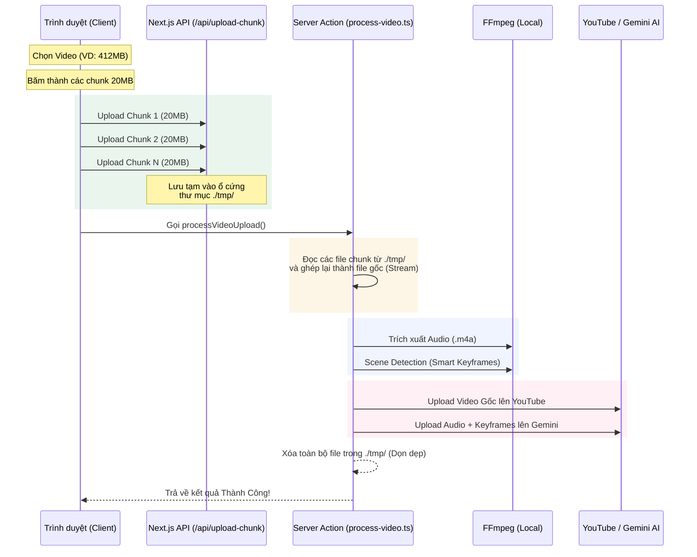

# Kiến trúc Upload & Xử lý Video Mới (Trực tiếp qua Server)

## Luồng xử lý (Architecture Flow)

Dưới đây là sơ đồ kiến trúc upload mới, đã bỏ qua bước trung gian Supabase để khắc phục lỗi giới hạn 50MB và tăng tốc độ xử lý:

## So sánh kiến trúc: Cũ vs Mới

### ❌ Kiến trúc cũ (Lỗi 50MB)
`Client` ➔ **`Supabase Storage`** ➔ `Server` ➔ `YouTube/Gemini`
- **Vấn đề 1:** Supabase Free tier giới hạn file 50MB, không lưu được file lớn.
- **Vấn đề 2:** Tốn gấp đôi thời gian upload (Client upload lên Supabase, sau đó Server lại phải download từ Supabase về).

### ✅ Kiến trúc mới (Direct Upload)
`Client` ➔ **`Server File System (Local /tmp)`** ➔ `YouTube/Gemini`
- **Giải quyết 1:** Bỏ qua giới hạn của Supabase, thoải mái upload file hàng GB (tùy thuộc vào dung lượng ổ cứng của server).
- **Giải quyết 2:** Tiết kiệm một bước "download", server ghép nối trực tiếp từ file local → tăng tốc xử lý đáng kể.

---

## Các thay đổi quan trọng trong Code

1. **Thêm API Route mới (`app/api/upload-chunk/route.ts`)**
   - Nhận binary raw data.
   - Lưu thẳng vào thư mục `tmp/` trên hệ thống.

2. **Cập nhật Client (`UploadVideoForm.tsx`)**
   - Không gọi `supabase.storage...upload()` nữa.
   - Gọi `fetch("/api/upload-chunk")` với method `POST` để đẩy file lên máy chủ cục bộ.

3. **Cập nhật Server (`process-video.ts`)**
   - Không gọi `supabase.storage...download()` nữa.
   - Dùng `fs.readFileSync(path.join(tempDir, chunk_name))` để đọc và ghép file.
   - Cuối cùng dọn dẹp bằng `fs.unlinkSync()` các file cục bộ thay vì xóa trên Supabase.
