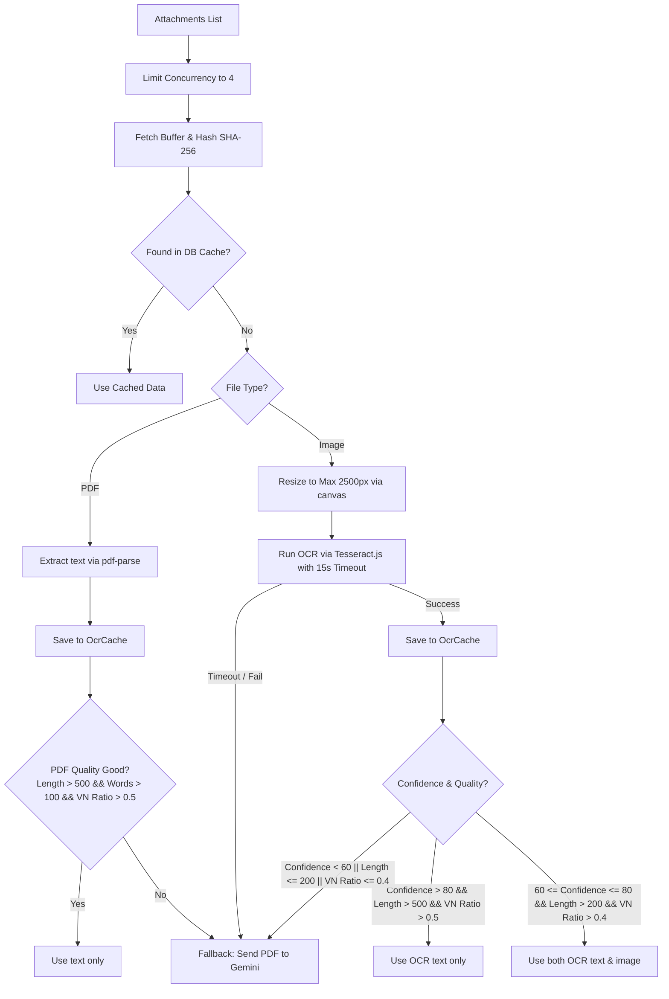

# Kế hoạch tối ưu hóa Token chấm điểm AI bằng Hybrid OCR & DB Cache (Cập nhật)

## Bối cảnh & Vấn đề Cần Giải Quyết

Khi chấm bài tự luận môn Ngữ Văn cho học sinh bằng Gemini 2.5 Flash, việc gửi trực tiếp các file ảnh hoặc PDF lớn lên API sẽ tiêu tốn lượng token đầu vào cực kỳ lớn, dẫn đến cạn kiệt hạn mức và chi phí cao. 

Dựa trên phản hồi và thiết kế cải tiến:
1. **Cache JSON file có nguy cơ lỗi scale**: Khi có nhiều request đồng thời, việc đọc/ghi file JSON dễ bị tranh chấp dữ liệu (corrupt) và lock file. Giải pháp là chuyển sang dùng **Postgres Database Cache (bảng `OcrCache`)** thông qua Prisma, đảm bảo an toàn, đồng nhất và scale tốt.
2. **Cách tính `vietnameseRatio` chính xác hơn**: Đếm tất cả ký tự trong bảng chữ cái Latin và tiếng Việt `[a-zA-ZÀ-Ỹà-ỹ]` thay vì chỉ ký tự có dấu.
3. **Cơ chế Hybrid an toàn chống mất dữ liệu**:
   * Chỉ khi OCR có độ tin cậy cực cao (`confidence > 80`) và văn bản đủ dài (`textLength > 500`) mới bỏ qua ảnh hoàn toàn.
   * Nếu ở mức trung bình (`60-80` và `length > 200`), gửi cả text OCR và ảnh gốc để Gemini đối chiếu nhanh và chính xác nhất.
   * Nếu thấp (`<60` hoặc quá ngắn), chỉ gửi ảnh gốc.
4. **OCR Worker Queue (Giới hạn tài nguyên CPU)**: Sử dụng Pool giới hạn số lượng tác vụ OCR chạy song song (ví dụ: tối đa 4 tác vụ song song) để tránh bão hòa CPU khi chấm nhiều bài cùng lúc.
5. **OCR Timeout & Resize ảnh**:
   * Thiết lập Timeout 15 giây cho Tesseract OCR. Nếu quá thời gian, tự động fallback gửi ảnh gốc trực tiếp lên Gemini.
   * Sử dụng thư viện `canvas` (đã có sẵn trong dự án) để resize ảnh lớn (> 2500px) xuống kích thước tối đa 2500px trước khi OCR, giúp giảm 50-80% thời gian chạy OCR mà không mất độ chính xác.

---

## Thiết kế Giải pháp

### 1. Model cơ sở dữ liệu `OcrCache` trong `schema.prisma`
```prisma
model OcrCache {
  hash      String   @id
  type      String   // "pdf" or "image"
  text      String
  meta      Json     // Lưu { confidence, textLength, wordCount, vietnameseRatio }
  createdAt DateTime @default(now())
}
```

### 2. Thuật toán phân tích chất lượng text tiếng Việt
```typescript
function countVietnameseChars(text: string): number {
    // Đếm tất cả ký tự Latin và tiếng Việt
    const matches = text.match(/[a-zA-ZàáạảãâầấậẩẫăằắặẳẵèéẹẻẽêềếệểễìíịỉĩòóọỏõôồốộổỗơờớợởỡùúụủũưừứựửữỳýỵỷỹđÀÁẠẢÃÂẦẤẬẨẪĂẰẮẶẲẴÈÉẸẺẼÊỀẾỆỂỄÌÍỊỈĨÒÓỌỎÕÔỒỐỘỔỖƠỜỚỢỞỠÙÚỤỦŨƯỪỨỰỬỮỲÝỴỶỸĐ]/g);
    return matches ? matches.length : 0;
}
```

### 3. Quy trình OCR & Fallback kèm Concurrency Limit



---

## Kế hoạch thay đổi chi tiết

### 1. Cơ sở dữ liệu (`prisma/schema.prisma`)
* Thêm model `OcrCache`.
* Chạy `npx prisma db push` để tạo bảng trên cơ sở dữ liệu.

### 2. Backend Server Actions (`app/actions/essay-grading.ts`)
* Viết hàm `countVietnameseChars`, hàm giới hạn concurrency (pool), hàm timeout, và hàm resize ảnh bằng `canvas`.
* Viết cơ chế lưu trữ và đọc cache từ bảng `OcrCache` qua Prisma.
* Cập nhật luồng xử lý song song trong `aiGradeEssay`.
* Thêm format rõ ràng `=== TRANG X ===` khi gộp text.

---

## Kế hoạch kiểm thử (Verification Plan)

### Automated Tests & Compile Verification
* Chạy `npx tsc --noEmit` để đảm bảo code TypeScript không bị lỗi kiểu dữ liệu.
* Chạy `npm run build` để kiểm định build.

### Manual Verification (Kiểm thử thực tế)
1. Kiểm tra cache: Chấm bài lần đầu xem console ghi nhận chạy OCR, chấm lần 2 chạy siêu tốc và ghi nhận "Loaded from DB cache".
2. Kiểm tra concurrency: Upload đồng thời 6 ảnh, quan sát console xem chỉ chạy tối đa 4 tác vụ OCR song song.
3. Kiểm tra timeout: Tạo ảnh giả lập chạy chậm để test timeout, đảm bảo fallback gửi ảnh gốc lên Gemini thành công.
4. Kiểm tra resize: Gửi ảnh dung lượng lớn (>3000px), kiểm tra console log xác nhận resize xuống 2500px trước khi OCR.
