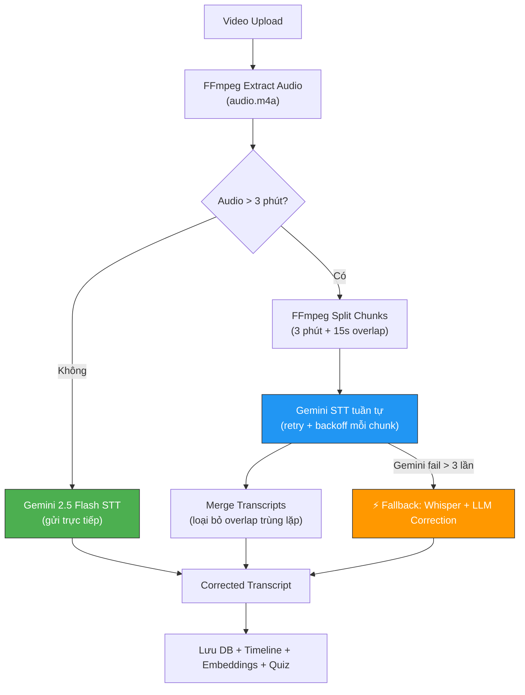
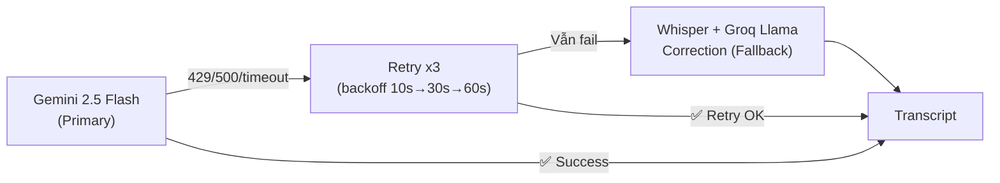

# Cải tiến STT Pipeline: Gemini-First + Chunked Audio + Whisper Fallback

## Bối cảnh

### Pipeline hiện tại
```
Video → FFmpeg audio (1 file) → Groq Whisper (whisper-large-v3, lang="vi") → Raw transcript → DB
```

### Vấn đề so sánh thực tế

| | Whisper (Groq) | Gemini 2.5 Flash |
|---|---|---|
| **Output** | "l v h kh ph Windows th n s x l nh th n ch h sau khi m load d li th n ph x l ra sao" | "đối với hệ điều hành không phải Windows thì nó sẽ xử lý như thế nào chẳng hạn. Sau khi load được dữ liệu thì nó phải xử lý ra sao" |
| **Thuật ngữ EN** | "Asian Skill" ❌ | "Agentic Skill" ✅ |
| **Ký tự đơn lẻ** | Hoàn toàn phá hủy ❌ | Nhận diện đúng ✅ |
| **File nặng** | Ổn định ✅ | Bị quota/rate-limit ⚠️ |

### Kết luận
**Gemini 2.5 Flash chất lượng vượt trội** nhưng cần xử lý vấn đề file nặng bị rate-limit. Giải pháp: **Chunked Audio + Retry + Fallback**.

---

## Thiết kế giải pháp: Chunked Gemini STT

### Ý tưởng cốt lõi

Thay vì gửi **1 file audio lớn** (30-60 phút, có thể 50-100MB), ta **chia thành nhiều chunks nhỏ** (3-5 phút mỗi chunk) và gửi tuần tự với retry logic:

```
1 audio file (45 phút)
    ↓ FFmpeg split
[Chunk 1: 0:00-3:00] [Chunk 2: 2:45-5:45] [Chunk 3: 5:30-8:30] ... [Chunk N]
    ↓                     ↓                     ↓                     ↓
 Gemini STT           Gemini STT           Gemini STT           Gemini STT
    ↓ (rate-limit? wait + retry)
[Transcript 1]  +  [Transcript 2]  +  [Transcript 3]  +  ... +  [Transcript N]
    ↓ merge (loại bỏ overlap trùng lặp)
Complete Corrected Transcript
```

### Tại sao chunking giải quyết được quota?

| Vấn đề | Nguyên nhân gốc | Chunking giải quyết |
|---------|-----------------|---------------------|
| **Rate limit (RPM)** | 1 request lớn chiếm quá nhiều token cùng lúc | Nhiều request nhỏ, mỗi cái chỉ ~3 phút audio |
| **Request timeout** | File quá lớn → xử lý lâu → timeout | Chunk nhỏ xử lý nhanh (< 30s/chunk) |
| **Token overflow** | File audio dài vượt context window | Mỗi chunk nằm gọn trong limit |
| **Retry granularity** | Nếu fail ở phút 30/45 → phải retry toàn bộ | Chỉ retry chunk bị fail, giữ lại chunks thành công |

---

## Proposed Changes

### Pipeline mới



---

### [NEW] [lib/transcript-gemini.ts](file:///f:/aura/aura/lib/transcript-gemini.ts)

Module mới chứa toàn bộ logic STT bằng Gemini:

**1. `splitAudioIntoChunks(audioPath, chunkDuration, overlap)`**
- Dùng FFmpeg chia file audio thành các chunks 3 phút
- Overlap 15 giây giữa các chunks (tránh mất từ ở biên)
- Trả về mảng đường dẫn file chunks

**2. `transcribeChunkWithGemini(chunkPath, courseContext, retryCount)`**
- Gửi 1 chunk audio tới Gemini 2.5 Flash để STT
- Prompt bao gồm course/chapter/lesson title làm vocabulary hints
- Retry với exponential backoff khi bị 429 (rate-limit):
  - Lần 1: đợi 10s → retry
  - Lần 2: đợi 30s → retry  
  - Lần 3: đợi 60s → retry
  - Lần 4+: fallback sang Whisper cho chunk này

**3. `mergeChunkTranscripts(transcripts[], overlapDuration)`**
- Ghép nối các transcript chunks
- Xử lý vùng overlap: dùng fuzzy matching để tìm điểm trùng lặp giữa tail(chunk N) và head(chunk N+1)
- Loại bỏ phần trùng, giữ version có quality cao hơn

**4. `transcribeWithGemini(audioPath, courseTitle, chapterTitle, lessonTitle)`**
- Orchestrator chính: quyết định chunk hay không, gọi tuần tự, merge, handle fallback
- Entry point duy nhất cho `process-video.ts`

---

### [MODIFY] [process-video.ts](file:///f:/aura/aura/app/actions/process-video.ts)

**Thay đổi 1 — Query course context (trước BƯỚC 3):**
```typescript
// Lấy context khóa học để cung cấp vocabulary hints cho STT
const chapter = await prisma.chapter.findUnique({
  where: { id: chapterId },
  include: { course: { select: { title: true, description: true } } }
});
const courseTitle = chapter?.course?.title || "";
const chapterTitle = chapter?.title || "";
```

**Thay đổi 2 — Thay Whisper bằng Gemini chunked STT (dòng 480-505):**
```typescript
// TRƯỚC:
const groqTranscriptionPromise = groq.audio.transcriptions.create({
  file: fs.createReadStream(audioFilePath),
  model: "whisper-large-v3",
  language: "vi",
  response_format: "json",
});

// SAU:
import { transcribeWithGemini } from "@/lib/transcript-gemini";

const geminiTranscriptionPromise = transcribeWithGemini(
  audioFilePath,
  courseTitle,
  chapterTitle,
  title, // lessonTitle
);
```

**Thay đổi 3 — Cập nhật error handling:**
- `transcribeWithGemini` tự xử lý fallback sang Whisper nội bộ
- `process-video.ts` không cần biết STT engine nào được dùng

---

### Gemini STT Prompt (chi tiết)

```
Bạn là chuyên gia bóc băng (transcription) bài giảng tiếng Việt chuyên ngành CNTT/Lập trình.

**NGỮ CẢNH BÀI HỌC:**
- Khóa học: "${courseTitle}"
- Chương: "${chapterTitle}"  
- Bài: "${lessonTitle}"

**NHIỆM VỤ:** Nghe đoạn audio và bóc băng chính xác thành văn bản tiếng Việt.

**QUY TẮC QUAN TRỌNG:**
1. Giảng viên Việt Nam thường phát âm thuật ngữ tiếng Anh theo kiểu Việt hóa.
   Hãy nhận diện và GHI ĐÚNG thuật ngữ gốc tiếng Anh.
   Ví dụ: "ây-dần" → "Agent", "phải-tôn" → "Python", "ríp-pót" → "report"
2. Khi giảng viên đánh vần từng chữ cái hoặc đọc code, hãy ghi chính xác ký tự.
3. Giữ nguyên cấu trúc câu tiếng Việt, chỉ sửa thuật ngữ kỹ thuật cho đúng.
4. KHÔNG tóm tắt, KHÔNG thêm nội dung, ghi chính xác những gì nghe được.

**OUTPUT:** Trả về TOÀN BỘ transcript dạng plain text (không markdown, không timestamp).
```

---

## Xử lý Overlap khi merge

Khi chia audio thành chunks có overlap 15s, transcript sẽ có phần trùng:

```
Chunk 1 transcript: "...skill này sẽ có những bộ phận như kiểu đây chính là một kỹ thuật viên"
Chunk 2 transcript: "đây chính là một kỹ thuật viên chuyên để viết code cho skill này..."
                     ^^^^^^^^^^^^^^^^^^^^^^^^^^^^^ overlap zone
```

**Thuật toán merge:**
1. Lấy 200 ký tự cuối của chunk N
2. Tìm chuỗi con dài nhất match với đầu chunk N+1 (fuzzy match, tolerance ~85%)
3. Cắt phần trùng khỏi chunk N+1
4. Nối lại

---

## Fallback Strategy



Khi Gemini fail sau 3 lần retry cho **1 chunk cụ thể**:
1. Gửi chunk đó sang Groq Whisper
2. Dùng Groq Llama 3.3 correction (như Tầng 2 trong plan cũ) để sửa lỗi Whisper
3. Merge kết quả fallback vào vị trí chunk đó

> [!TIP]
> Lợi thế: Nếu video 45 phút chia thành 15 chunks, chỉ 2-3 chunks bị rate-limit thì chỉ 2-3 chunks đó dùng Whisper fallback. 80% transcript vẫn từ Gemini chất lượng cao.

---

## Ước tính thời gian xử lý

| Video | Chunks (3 phút) | Gemini (tuần tự) | Whisper cũ | Chênh lệch |
|-------|-----------------|-------------------|------------|-------------|
| 5 phút | 2 chunks | ~20s | ~10s | +10s |
| 15 phút | 5 chunks | ~50s | ~25s | +25s |
| 30 phút | 10 chunks | ~100s | ~45s | +55s |
| 60 phút | 20 chunks | ~200s | ~80s | +120s |

> [!NOTE]
> Thời gian tăng nhưng **chất lượng transcript tăng đáng kể**. Và quá trình chạy ngầm (background) nên user không bị block.

---

## Open Questions

> [!IMPORTANT]
> **Q1:** Chunk size nên là bao nhiêu phút? Đề xuất **3 phút** (cân bằng giữa context quality và rate-limit safety). Hay bạn muốn thử 5 phút?

> [!WARNING]
> **Q2:** Gemini Files API lưu file 48 giờ. Cần cleanup tự động sau khi transcribe xong. OK?

> [!NOTE]
> **Q3:** Có muốn log lại chunk nào dùng Gemini, chunk nào fallback Whisper để theo dõi tỷ lệ fallback không?

---

## Verification Plan

### Automated Tests
- Upload video mẫu có chứa thuật ngữ "Agentic Skill" / "Agent" / đánh vần code
- So sánh transcript mới (Gemini) vs cũ (Whisper) 
- Verify pipeline downstream (timeline, quiz, embeddings) không bị break

### Manual Verification  
- Upload video ngắn (< 5 phút) → verify Gemini xử lý trực tiếp
- Upload video dài (> 20 phút) → verify chunking + merge hoạt động đúng
- Simulate Gemini rate-limit → verify fallback Whisper hoạt động
- Kiểm tra transcript trong Instructor Dashboard
