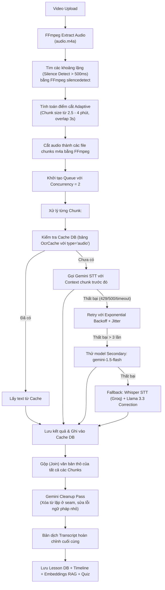

# Cải tiến STT Pipeline: Kiến trúc Adaptive Gemini STT & Fallback Chain

Hệ thống bóc băng (STT) hiện tại sử dụng Groq Whisper bóc băng trực tiếp tiếng Việt dẫn đến mất mát các thuật ngữ tiếng nước ngoài (ví dụ: "Agent" -> "Asian") và lỗi khi giảng viên đọc từng ký tự lập trình.

Để khắc phục triệt để, chúng tôi nâng cấp toàn bộ STT pipeline sang **Gemini-First kết hợp Adaptive Chunking và Fallback Chain**.

---

## 🛠️ Thiết kế Kiến trúc STT mới

Quy trình xử lý một file audio bài giảng chi tiết như sau:

---

## ⚙️ Các Cải tiến Chi tiết

### 1. Phân tách Thích ứng (Adaptive Chunking) thay vì chia cứng
* Dùng bộ lọc `silencedetect` của FFmpeg để phát hiện các khoảng dừng nói > 500ms.
* Mục tiêu chunk size: **180 giây (3 phút)**.
* Thuật toán sẽ tìm điểm tĩnh (silence) gần mốc 180s nhất trong khoảng từ **150s (2.5 phút) đến 240s (4 phút)** để thực hiện cắt.
* Việc này đảm bảo không cắt ngang câu nói của giảng viên, giúp Gemini giữ trọn vẹn ngữ cảnh ngữ nghĩa.

### 2. Overlap cực ngắn (3 giây) + Previous Chunk Context
* Thay vì overlap 15s gây lãng phí token, chúng ta rút ngắn overlap xuống **3 giây**.
* Bù lại, prompt gửi lên Gemini cho Chunk $N$ sẽ chứa **1000 ký tự cuối** của Chunk $N-1$ đã được transcribe làm ngữ cảnh nối ý.

### 3. Queue xử lý với Concurrency = 2
* Transcribe các chunks song song với giới hạn concurrency là 2 để tối ưu hóa tốc độ xử lý mà không làm quá tải quota API.

### 4. Cache DB cấp độ Chunk (OcrCache)
* Mỗi chunk m4a sau khi cắt sẽ được tính mã hash SHA-256 của file buffer.
* Lưu và đọc transcript từ bảng `OcrCache` (với `type: "audio"`). Nếu server restart hoặc chạy lại, các chunk đã làm xong sẽ được tái sử dụng ngay lập tức, tiết kiệm 100% thời gian và chi phí API cho các chunk đó.

### 5. Model Fallback Chain & Retry có Jitter
* **Primary:** `gemini-2.5-flash`
* **Secondary:** `gemini-1.5-flash`
* **Tertiary Fallback:** `whisper-large-v3` trên Groq + `llama-3.3-70b-versatile` để hiệu chỉnh từ vựng.
* **Retry:** Exponential backoff ($2^{\text{attempt}} \times 2000\text{ms}$) kết hợp **Random Jitter (0 - 1000ms)** để phân tán request.

### 6. Gemini Cleanup Pass cuối cùng
* Toàn bộ các chunk sau khi nối lại sẽ chạy qua một lượt hiệu chỉnh bằng Gemini (sử dụng text-only model nên cực kỳ rẻ và nhanh).
* Prompt chuyên biệt để xóa phần lặp ở seams gối đầu và sửa các lỗi typo nhỏ mà không làm thay đổi nội dung gốc.
* Với các video dài (> 20,000 ký tự), text sẽ được chia thành các khối 15,000 ký tự để hiệu đính an toàn, tránh bị cắt cụt (truncation).

---

## 📂 Proposed Changes

### [NEW] [transcript-gemini.ts](file:///f:/aura/aura/lib/transcript-gemini.ts)
* Chứa toàn bộ logic:
  * Silence detection bằng FFmpeg.
  * Adaptive chunk calculation.
  * Audio slicing.
  * Gemini API call với inline audio (dạng base64) và fallback chain.
  * Caching qua Prisma `OcrCache`.
  * Gemini Cleanup Pass.
  * Logging chi tiết từng chunk (`chunk_id`, `duration`, `latency`, `model`, `cached`, `isFallback`).

### [MODIFY] [process-video.ts](file:///f:/aura/aura/app/actions/process-video.ts)
* Import `transcribeWithGemini` từ `@/lib/transcript-gemini`.
* Query thông tin khóa học (`courseTitle`, `chapterTitle`, `lessonTitle`) để làm context đầu vào.
* Thay thế đoạn gọi Groq Whisper cũ (BƯỚC 3, dòng 480-489) bằng việc gọi trực tiếp hàm mới.

---

## 🔍 Verification Plan

### 1. Kiểm thử Tự động
* Chạy thử script test STT độc lập trên 1 video ngắn có tiếng Anh và tiếng Việt đan xen.
* Xác nhận:
  * Không bị lỗi keyframe, file audio m4a sinh ra hợp lệ.
  * Cache lưu đúng vào DB.
  * Khi gọi lại lần 2, thời gian xử lý gần như = 0s do cache.

### 2. Kiểm thử Thủ công trên Giao diện
* Upload video giảng dạy thực tế lên hệ thống thông qua trang Admin Course.
* Kiểm tra tiến độ xử lý ngầm qua console server log chi tiết (table stats).
* Verify:
  * Bản dịch transcript cuối cùng hiển thị trôi chảy, không có dấu nối lặp câu.
  * Các câu hỏi trắc nghiệm (Quiz) sinh ra dùng đúng thuật ngữ (ví dụ "Agentic Skill", "Python", "Anti-Gravity").
