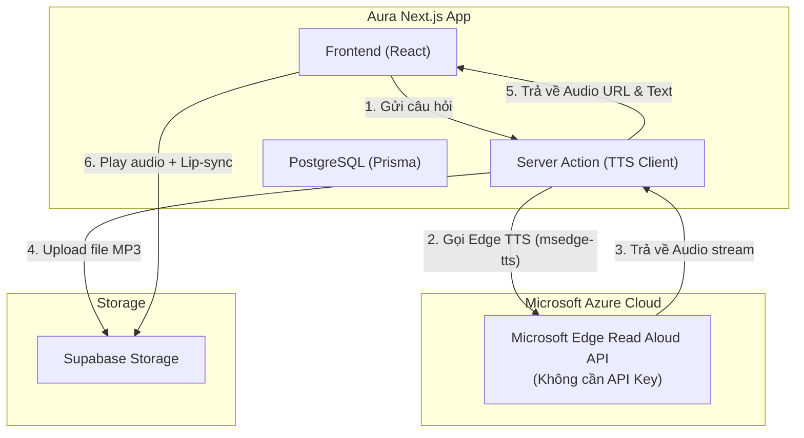

# 🤖 Trợ Lý Ảo 3D RAG — Phong cách Jarvis (Sử dụng Edge TTS)

## Tổng quan

Xây dựng **Trợ lý ảo 3D** cho Aura Learning — một avatar 3D có khả năng:
- **Nói chuyện** bằng giọng Tiếng Việt tự nhiên chất lượng cao thông qua **Microsoft Edge TTS** (hoàn toàn miễn phí, chất lượng tương đương Microsoft Azure Neural TTS).
- **Lip-sync** (cử động môi) đồng bộ với giọng nói.
- **Hiểu bài giảng** thông qua RAG/Embedding (tìm kiếm ngữ nghĩa trên transcript).
- **Cá nhân hóa** — giải quyết đúng "điểm mù" kiến thức của từng sinh viên.

---

## ⚡ Giải pháp Khắc phục Điểm Yếu Cốt Tử

### 1. Khắc phục Hội chứng "Trang giấy trắng" (Active Socratic Tutor)
*   **Lời chào chủ động (Socratic Greeting)**: Khi sinh viên mở bài học, Jarvis sẽ tự động chào và tóm tắt nhanh 3 ý chính của bài giảng, đồng thời đưa ra 1 câu hỏi gợi mở dạng Socratic để kích thích tư duy.
*   **Gợi ý câu hỏi động (Dynamic Suggested Questions)**: Sử dụng Gemini để đọc transcript và sinh sẵn **4 câu hỏi thảo luận cụ thể** của riêng bài học đó. Sinh viên chỉ cần click để hỏi.
*   **Menu tương tác nhanh**: Hiển thị các shortcut trực quan ngay dưới khung chat:
    *   `🧠 Xem Mindmap`: Gọi tab Mindmap của bài học.
    *   `🎴 Ôn tập Flashcards`: Bắt đầu học flashcard.
    *   `📝 Làm trắc nghiệm`: Mở Quiz AI.

### 2. Khắc phục Rủi ro "Ảo giác" (Strict RAG & Context Verification)
*   **System Prompt hai lớp (Double-Constraint Prompting)**: Quy tắc nghiêm ngặt: Chỉ được khẳng định thông tin nếu có trong giáo trình video. Nếu không có, bắt buộc phải trả lời: *"📌 Giáo trình bài học hiện tại không đề cập đến thông tin này. Tuy nhiên bạn có thể tham khảo thêm..."*
*   **Chỉ số tin cậy (Confidence Score Check)**: Khi tìm kiếm vector search trong Supabase, nếu điểm tương đồng lớn nhất `similarity` < `0.45`, giao diện sẽ hiển thị cảnh báo `⚠️ Phản hồi này sử dụng kiến thức mở rộng ngoài giáo trình`.
*   **Cơ chế Trích dẫn nguồn tối cao (Strict Citations)**: Mọi thông tin Jarvis đưa ra phải đi kèm nhãn timestamp (Ví dụ: `[12:34]`). Click vào timestamp này sẽ tự động tua video đến đúng thời điểm giảng viên nói đoạn kiến thức đó.

---

## Kiến trúc Hệ Thống



---

## Proposed Changes

### Component 1: Thư viện mới

Cài đặt thư viện `msedge-tts` cho Node.js:
```bash
npm install msedge-tts
```

---

### Component 2: Database Schema

#### [MODIFY] [schema.prisma](file:///f:/aura/aura/prisma/schema.prisma)

Thêm các model mới phục vụ Jarvis và cấu hình giọng đọc Microsoft Edge:

```prisma
// ================= AI LECTURE GENERATION & ASSISTANT =================

enum LessonContentType {
  YOUTUBE_VIDEO
  AI_GENERATED
}

enum ScriptStatus {
  DRAFT
  GENERATING
  READY
  ERROR
}

model LectureScript {
  id        String       @id @default(uuid())
  lessonId  String       @unique
  lesson    Lesson       @relation(fields: [lessonId], references: [id], onDelete: Cascade)

  // Edge TTS Config  
  voiceId       String   @default("vi-VN-HoaiMyNeural") // vi-VN-HoaiMyNeural (Nữ) | vi-VN-NamMinhNeural (Nam)
  speed         String   @default("+0%")                // Tốc độ điều chỉnh bằng %
  
  // Template & Style
  brandColor    String   @default("#C5A059")
  fontFamily    String   @default("Inter")

  // Generated Output
  totalDuration Int?     
  status        ScriptStatus @default(DRAFT)
  errorMessage  String?

  segments  LectureSegment[]

  createdAt DateTime @default(now())
  updatedAt DateTime @updatedAt
}

model LectureSegment {
  id        String        @id @default(uuid())
  scriptId  String
  script    LectureScript @relation(fields: [scriptId], references: [id], onDelete: Cascade)

  position  Int           

  // Slide Content
  slideTitle    String?
  slideContent  String    @db.Text   
  slideLayout   String    @default("TITLE_BODY")
  slideImageUrl String?

  // AI Narration
  narrationText String    @db.Text   

  // Generated Audio
  audioUrl      String?              
  audioDuration Float?               
  audioStatus   String    @default("pending") 

  // Animation
  animation     String    @default("fade")

  createdAt DateTime @default(now())

  @@index([scriptId])
}
```

---

### Component 3: RAG & Anti-Hallucination Pipeline

#### [MODIFY] [app/actions/video-chat.ts](file:///f:/aura/aura/app/actions/video-chat.ts)

Cập nhật lại API tìm kiếm ngữ cảnh:

```typescript
"use server";

import { createClient } from "@/utils/supabase/server";
import { generateEmbedding } from "@/lib/ai/embedding";
import { google } from "@ai-sdk/google";
import { streamText } from "ai";

interface VideoSegment {
    id: string;
    content: string;
    start_time: number;
    end_time: number;
    similarity: number;
}

export async function chatWithVideo3D(lessonId: string, query: string) {
    const supabase = await createClient();
    const { data: { user } } = await supabase.auth.getUser();
    if (!user) return { error: "Unauthorized", status: 401 };

    try {
        const queryEmbedding = await generateEmbedding(query);
        if (!queryEmbedding || queryEmbedding.length === 0) {
            throw new Error("Không thể tạo embedding cho câu hỏi");
        }

        const { data: segments, error } = await supabase.rpc('match_video_segments', {
            query_embedding: queryEmbedding,
            match_threshold: 0.25,
            match_count: 5,
            filter_lesson_id: lessonId
        });

        if (error) throw error;
        const matchedSegments = (segments as VideoSegment[]) || [];

        const maxSimilarity = matchedSegments.length > 0 ? Math.max(...matchedSegments.map(s => s.similarity)) : 0;
        const isFromCurriculum = maxSimilarity >= 0.45;

        let contextText = "";
        if (matchedSegments.length > 0) {
            contextText = matchedSegments
                .map(s => `[Thời điểm ${formatTime(s.start_time)} - ${formatTime(s.end_time)} (Độ tương đồng: ${s.similarity.toFixed(2)})]: ${s.content}`)
                .join("\n\n");
        }

        const systemPrompt = `
Bạn là Jarvis - Trợ lý ảo AI học tập thông minh tại Aura LMS.

NGUỒN THÔNG TIN DUY NHẤT:
- Dưới đây là nội dung giảng dạy trong video bài giảng:
${contextText}

QUY TẮC PHÒNG CHỐNG ẢO GIÁC (HALLUCINATION) CỰC KỲ NGHIÊM NGẶT:
1. Bạn chỉ được khẳng định là đúng nếu thông tin đó xuất hiện trong nội dung video bài giảng phía trên.
2. Nếu câu hỏi yêu cầu thông tin không có trong video bài giảng:
   - Bạn PHẢI nói rõ: "📌 Giáo trình bài học hiện tại không đề cập đến thông tin này."
   - Sau đó, bạn có thể trả lời ngắn gọn dựa trên kiến thức bên ngoài nhưng PHẢI nhấn mạnh đó là "Kiến thức mở rộng tham khảo". Tuyệt đối không được gán ghép kiến thức ngoài đó là của bài học.
3. Luôn luôn trích dẫn timestamp dưới định dạng [MM:SS] (ví dụ: "[02:15]") khi nói về nội dung xuất hiện trong bài giảng.
4. Trả lời bằng tiếng Việt, ngắn gọn, súc tích, đi thẳng vào vấn đề sinh viên thắc mắc.

CẤU TRÚC PHẢN HỒI BẮT BUỘC:
[Nội dung câu trả lời]
💡 **Câu hỏi gợi ý tiếp theo:**
* [Câu hỏi gợi ý 1]
* [Câu hỏi gợi ý 2]
`;

        const result = await streamText({
            model: google('gemini-2.5-flash'),
            messages: [
                { role: "system", content: systemPrompt },
                { role: "user", content: query }
            ]
        });

        return {
            textStream: result.textStream,
            isFromCurriculum,
            maxSimilarity
        };

    } catch (e: any) {
        console.error(e);
        return { error: e.message };
    }
}

function formatTime(seconds: number) {
    const m = Math.floor(seconds / 60);
    const s = Math.floor(seconds % 60);
    return `${m.toString().padStart(2, '0')}:${s.toString().padStart(2, '0')}`;
}
```

---

### Component 4: TTS Pipeline using Microsoft Edge TTS

#### [NEW] `app/actions/tts-speak.ts`

Sử dụng thư viện `msedge-tts` để sinh giọng nói Azure hoàn toàn miễn phí và upload trực tiếp lên Supabase:

```typescript
"use server";

import { createClient } from "@/utils/supabase/server";
import { MsEdgeTTS, OUTPUT_FORMAT } from "msedge-tts";

export async function generateSpeech(text: string, voiceId = "vi-VN-HoaiMyNeural") {
    try {
        const tts = new MsEdgeTTS();
        
        // Cấu hình giọng đọc và chất lượng audio đầu ra
        await tts.setMetadata(voiceId, OUTPUT_FORMAT.AUDIO_24KHZ_48KBITRATE_MONO_MP3);
        
        // Tạo stream từ text
        const { audioStream } = tts.toStream(text.substring(0, 4000));
        
        // Thu thập buffer
        const chunks: Buffer[] = [];
        const audioBuffer = await new Promise<Buffer>((resolve, reject) => {
            audioStream.on("data", (chunk: Buffer) => chunks.push(chunk));
            audioStream.on("close", () => resolve(Buffer.concat(chunks)));
            audioStream.on("error", (err) => reject(err));
        });

        // Upload trực tiếp lên Supabase Storage
        const supabase = await createClient();
        const fileName = `jarvis-audio/${Date.now()}.mp3`;
        
        const { error: uploadError } = await supabase.storage
            .from("lecture-audio")
            .upload(fileName, audioBuffer, {
                contentType: "audio/mpeg",
                upsert: true
            });

        if (uploadError) throw uploadError;

        const { data: urlData } = supabase.storage
            .from("lecture-audio")
            .getPublicUrl(fileName);

        return { success: true, audioUrl: urlData.publicUrl };

    } catch (error: any) {
        console.error("Lỗi Edge TTS:", error);
        return { success: false, error: error.message };
    }
}
```

---

### Component 5: API Route cho 3D Jarvis Response

#### [NEW] `app/api/chat/video-3d/route.ts`

```typescript
import { chatWithVideo3D } from "@/app/actions/video-chat";
import { generateSpeech } from "@/app/actions/tts-speak";

export async function POST(req: Request) {
    try {
        const { lessonId, query, voice } = await req.json();

        // 1. Lấy phản hồi text từ RAG
        const ragResult = await chatWithVideo3D(lessonId, query);
        if (ragResult.error) throw new Error(ragResult.error);

        // Đọc stream text thành chuỗi
        let responseText = "";
        const reader = ragResult.textStream.getReader();
        while (true) {
            const { done, value } = await reader.read();
            if (done) break;
            responseText += value;
        }

        // 2. Chuyển đổi text thành audio bằng Edge TTS
        const ttsResult = await generateSpeech(responseText, voice || "vi-VN-HoaiMyNeural");

        return Response.json({
            text: responseText,
            audioUrl: ttsResult.success ? ttsResult.audioUrl : null,
            isFromCurriculum: ragResult.isFromCurriculum,
            maxSimilarity: ragResult.maxSimilarity,
            error: ttsResult.success ? null : ttsResult.error
        });

    } catch (error: any) {
        console.error(error);
        return Response.json({ error: error.message }, { status: 500 });
    }
}
```

---

### Component 6: UI & Canvas Integration

Các component UI chính:
- **AuraAvatar3D.tsx**: Animate cử động miệng avatar dựa trên tần số âm thanh bằng Web Audio API.
- **JarvisAssistant.tsx**: Tích hợp Socratic Greeting + gợi ý câu hỏi thông minh + Canvas 3D.
vẫn được giữ nguyên theo thiết kế Active Learning trước đây.

---

## Verification Plan

### Automated & Manual Tests

1.  **Cài đặt**:
    ```bash
    npm install msedge-tts
    ```

2.  **Test Edge TTS Client**:
    *   Truy cập trang bài học -> click Jarvis.
    *   Hỏi một câu bất kỳ -> Jarvis trả lời bằng giọng nữ (Hoài Mỹ) hoặc nam (Nam Minh).
    *   Xác nhận không phát sinh chi phí hoặc lỗi giới hạn credit.
