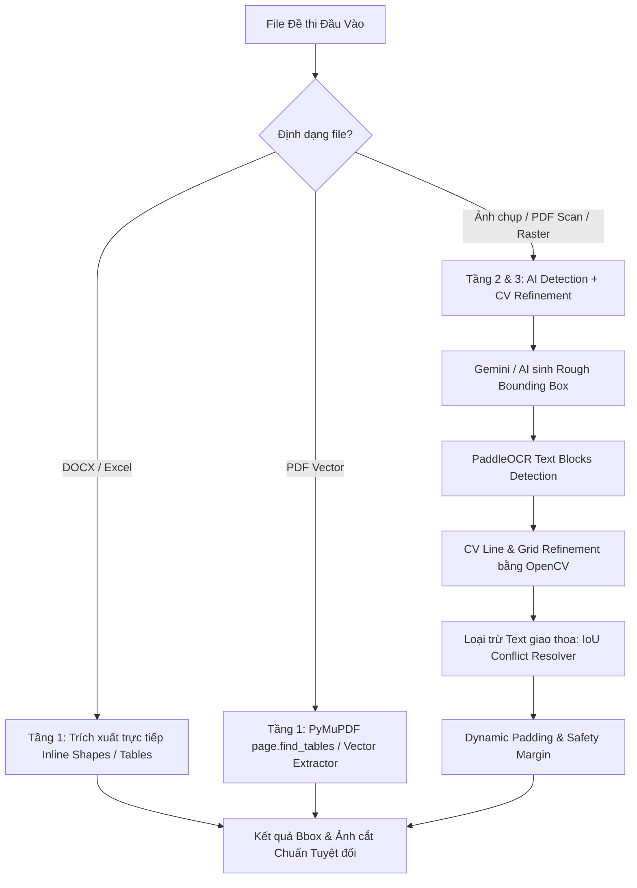

# Kế hoạch Thực thi: Khắc phục Triệt để Bounding Box Bị Lệch, Chèn Chữ & Cụt Đáy trong Đề thi Toán

Hiện tượng bounding box bảng biến thiên và hình vẽ đề thi bị chèn dòng chữ phía trên ("Câu...", "B. 0, 1...") và bị cắt cụt hàng giá trị $y$ phía dưới xuất phát từ việc phụ thuộc đơn thuần vào tọa độ ước lượng của LLM (Gemini `imageBbox`) kết hợp hàm crop tĩnh.

Tài liệu này đề xuất kiến trúc giải pháp **Hybrid Multi-Stage Pipeline** (kết hợp bóc tách file gốc, tinh chỉnh thị giác máy tính OpenCV, và AI Layout conflict resolution).

---

## Phân Tích Nguyên Nhân Gốc Rễ (Root Cause)

1. **LLM Spatial Inaccuracy**: Mô hình ngôn ngữ lớn (LLM) nội suy tọa độ pixel dựa trên patch visual tokens (độ phân giải thấp hơn ảnh gốc), dẫn đến sai số từ 15-40px ở các mép trên/dưới.
2. **Thiếu bước Boundary Refinement**: Sau khi LLM sinh tọa độ thô (`rough bbox`), hệ thống crop trực tiếp bằng `sharp` mà không có bước Computer Vision kiểm tra xem mép trên có cắt ngang chữ đề bài hay không, và mép dưới đã chạm đến đường viền đáy bảng hay chưa.
3. **Chưa tận dụng thông tin Text Bounding Box**: Hệ thống đã có PaddleOCR (trả về tọa độ chính xác từng dòng chữ), nhưng chưa so sánh vùng giao (IoU) giữa `imageBbox` và text block để tự động loại trừ text.

---

## Kiến Trúc Giải Pháp 3 Tầng (Hybrid Pipeline)

---

## Proposed Changes

### 1. Module Python Backend (`ocr-service`)

Nâng cấp microservice FastAPI hiện có tại `ocr-service` để đảm nhiệm tính năng tinh chỉnh thị giác máy tính (CV Table & Line Refinement) và xử lý file gốc.

#### [MODIFY] [ocr-service/requirements.txt](file:///home/giang/aura/ocr-service/requirements.txt)
- Thêm `opencv-python-headless>=4.8.0`
- Thêm `PyMuPDF>=1.23.0` (fitz)
- Thêm `python-docx>=1.1.0`

#### [MODIFY] [ocr-service/main.py](file:///home/giang/aura/ocr-service/main.py)
Bổ sung các API chuyên dụng:
1. `POST /api/v1/refine-bbox`:
   - Nhận ảnh gốc (hoặc crop ROI) + `rough_bbox: [ymin, xmin, ymax, xmax]` + `text_blocks` (tọa độ chữ từ OCR).
   - **Xử lý bảng biến thiên / bảng biểu bằng Morphological Operations**:
     - Grayscale $\rightarrow$ Nhị phân hóa (Otsu Threshold).
     - Tạo kernel ngang `cv2.getStructuringElement(cv2.MORPH_RECT, (kernel_w, 1))` và kernel dọc `(1, kernel_h)` để lọc các nét kẻ của bảng.
     - Tìm đường kẻ ngang trên cùng $\rightarrow$ chốt `ymin` chính xác tại mép trên của khung bảng.
     - Tìm đường kẻ ngang dưới cùng $\rightarrow$ chốt `ymax` bao trọn đáy hàng $y$.
     - Thêm bottom padding linh hoạt (10-15px) cho phần mũi tên / giá trị âm vô cùng.
   - **Giải quyết xung đột chữ (Text Conflict Resolver)**:
     - Kiểm tra nếu `ymin` bị dính hoặc cắt ngang text block câu hỏi/đáp án phía trên (dựa trên PaddleOCR bounding box) $\rightarrow$ đẩy `ymin` xuống dưới text block đó (`ymin = max(ymin, text_ymax + 2)`).
2. `POST /api/v1/extract-native`:
   - Trích xuất ảnh/bảng trực tiếp từ file DOCX (`docx2python` hoặc `python-docx` inline_shapes) hoặc PDF vector (`page.find_tables()`).

---

### 2. Module Next.js Core Parser (`lib/worksheet-parser.ts`)

#### [MODIFY] [lib/worksheet-parser.ts](file:///home/giang/aura/lib/worksheet-parser.ts)
1. **Tinh chỉnh Hàm `extractImageCrop`**:
   - Khi có `imageBbox` từ Gemini, gửi request sang endpoint `refine-bbox` của `ocr-service` để tự động snap vào đường viền bảng thật và gạt bỏ chữ câu hỏi.
   - Bổ sung fallback thuần JS/Sharp: Nếu service Python bận, áp dụng thuật toán phân tích histogram dòng sáng/tối để đẩy `top` vượt qua vùng văn bản trước khi crop.
2. **Cải thiện Prompt Gemini (`buildMultiSubjectPrompt`)**:
   - Thêm quy tắc ràng buộc cứng cho Bảng Biến Thiên:
     > *"QUY TẮC MẶNG: `ymin` BẮT ĐẦU từ đường kẻ ngang phân cách tiêu đề bảng hoặc hàng đầu tiên $x$. TUYỆT ĐỐI không bao gồm dòng text câu hỏi. `ymax` PHẢI kéo vượt qua đường kẻ đáy dưới cùng của bảng để không làm mất giá trị cực trị hàng $y$."*
3. **Xử lý Định Dạng File Gốc**:
   - Trong `parseQuestionsFromFile`: Nếu file là `.docx` hoặc PDF vector, kích hoạt nhánh trích xuất native asset trước khi render ảnh toàn trang.

---

### 3. Cấu hình & Tích Hợp Runner

#### [MODIFY] [ocr-service/run_service.bat](file:///home/giang/aura/ocr-service/run_service.bat)
- Cập nhật script cài đặt dependency bổ sung (opencv, pymupdf, python-docx) vào virtualenv.

---

## Kế Hoạch Triển Khai Theo Từng Giai Đoạn (Phased Rollout)

### Giai đoạn 1: Triển khai CV Line Refinement & Text Conflict Resolver (Ưu tiên cao nhất - Giải quyết ngay trên ảnh)
- Cài đặt `opencv-python-headless` vào `ocr-service`.
- Viết module `table_refiner.py`:
  - Hàm `detect_table_lines(image_roi)` dùng phép toán hình thái học (Morphological line detection).
  - Hàm `resolve_text_overlap(bbox, text_blocks)` khử triệt để tình trạng chèn chữ đề bài/đáp án.
- Kết nối `lib/worksheet-parser.ts` với `ocr-service/api/v1/refine-bbox`.

### Giai đoạn 2: Cải tiến Prompting & Dynamic Safety Padding
- Cập nhật prompt Gemini trong `lib/worksheet-parser.ts` với hướng dẫn trực quan hóa tọa độ chặt chẽ.
- Tự động điều chỉnh `cropBottom` trong `extractImageCrop` có biên an toàn đáy cho hàng $y$.

### Giai đoạn 3: Bóc tách trực tiếp từ File Gốc (DOCX & Vector PDF)
- Tích hợp PyMuPDF `find_tables()` và python-docx trích xuất inline images cho đề thi dạng số.
- Đảm bảo chất lượng ảnh 100% vector không bị mờ/vỡ hạt hoặc lệch mép.

---

## Verification Plan

### Automated / Script Tests
1. **Kiểm tra module OpenCV Refinement**:
   - Viết script Python test đơn vị `ocr-service/test_refinement.py` trên 3 mẫu ảnh thực tế:
     - Mẫu 1: Bảng biến thiên có chữ đề bài sát mép trên.
     - Mẫu 2: Bảng biến thiên có giá trị hàng $y$ sát mép dưới.
     - Mẫu 3: Hình vẽ hình học không gian có nhãn đỉnh $A_1$, đáy $A'B'C'D'$.
   - Lệnh chạy: `python ocr-service/test_refinement.py`
   - Tiêu chí đạt: Bounding box mới loại bỏ 100% text đề bài phía trên, và không bị cắt mất đường viền đáy bảng.

2. **Kiểm tra tích hợp TypeScript (`worksheet-parser.ts`)**:
   - Chạy script kiểm thử parse đề thi: `npx tsx scripts/test-bbox-refine.ts`
   - Đảm bảo ảnh Base64 xuất ra có đầy đủ hàng $y$ và không có dòng "Câu ... / B. 0, 1...".

### Manual Verification
- Sử dụng giao diện Import Đề Thi trên web Aura (`/instructor/courses/.../quiz`).
- Tải lên 1 đề thi Toán chứa bảng biến thiên và kiểm tra ảnh preview câu hỏi trực tiếp trên trình duyệt.
